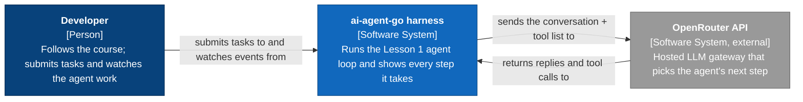
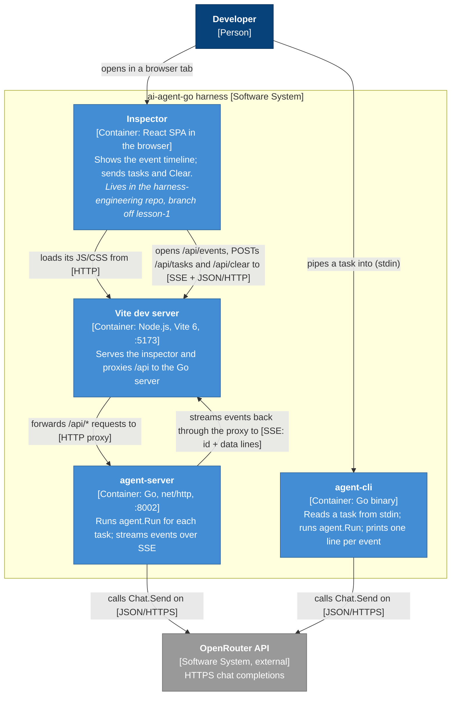
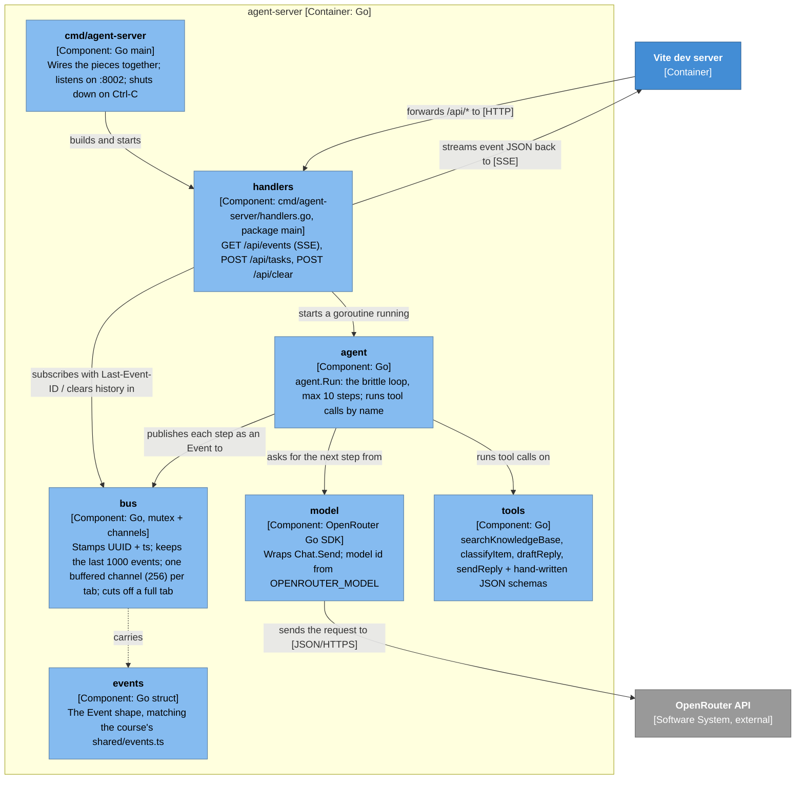
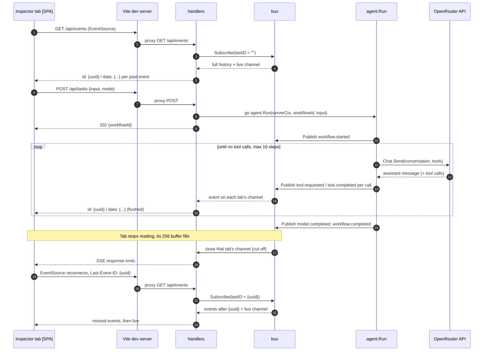

# ae-arch: Lesson 1 harness in Go (SSE inspector + agent loop)

> **Status:** Draft
> **Last updated:** 2026-10-16
> **From:** ae-plan/lesson-1-harness.md

The developer sends a task from the course's inspector or from `agent-cli`. The Go agent loop, `agent.Run`, works the task by calling OpenRouter and four fake support tools, and reports every step as a course-shaped event. In the server, events go to an in-memory bus. The bus streams them over SSE to every open inspector tab and replays its history when a tab reconnects. In the CLI, the same loop prints one line per event. Nothing is stored on disk yet; that's Lesson 2.

## 1. System context



```
System context diagram for the ai-agent-go harness

+----------------------+                              +--------------------------+
| Developer            |  submits tasks to and        | ai-agent-go harness      |
| [Person]             |  watches events from         | [Software System]        |
| Follows the course;  |----------------------------->| Runs the Lesson 1 agent  |
| submits tasks and    |                              | loop and shows every     |
| watches the agent    |                              | step it takes            |
+----------------------+                              +--------------------------+
                                                         |                   ^
                         sends the conversation +        |                   | returns replies and
                         tool list to                    v                   | tool calls to
                                                      +--------------------------+
                                                      | OpenRouter API           |
                                                      | [Software System, ext.]  |
                                                      | Hosted LLM gateway that  |
                                                      | picks the agent's next   |
                                                      | step                     |
                                                      +--------------------------+

Key: [Person] dark blue · [Software System] blue · external system grey · arrows are one-way
```

## 2. Containers



```
Container diagram for the ai-agent-go harness

                         +------------------+
                         | Developer        |
                         | [Person]         |
                         +------------------+
                    opens in a |        | pipes a task into (stdin)
                   browser tab v        v
+- ai-agent-go harness [Software System] -------------------------------------------+
|                                                                                   |
|  +---------------------------+                       +--------------------------+ |
|  | Inspector                 |                       | agent-cli                | |
|  | [Container: React SPA]    |                       | [Container: Go binary]   | |
|  | Event timeline; sends     |                       | stdin task -> agent.Run  | |
|  | tasks and Clear           |                       | -> one line per event    | |
|  | (harness-engineering repo)|                       +--------------------------+ |
|  +---------------------------+                                    |               |
|     | loads JS/CSS [HTTP]                                         |               |
|     | /api/events, /api/tasks, /api/clear [SSE + JSON/HTTP]       |               |
|     v                                                             |               |
|  +---------------------------+                                    |               |
|  | Vite dev server           |                                    |               |
|  | [Container: Node, :5173]  |                                    |               |
|  | Serves the SPA; proxies   |                                    |               |
|  | /api to the Go server     |                                    |               |
|  +---------------------------+                                    |               |
|     | forwards /api/*    ^ streams events back                    |               |
|     | [HTTP proxy]       | [SSE: id + data lines]                 |               |
|     v                    |                                        |               |
|  +---------------------------+                                    |               |
|  | agent-server              |                                    |               |
|  | [Container: Go, :8002]    |                                    |               |
|  | agent.Run per task;       |                                    |               |
|  | SSE event stream          |                                    |               |
|  +---------------------------+                                    |               |
+-----|-------------------------------------------------------------|---------------+
      | calls Chat.Send [JSON/HTTPS]                                | calls Chat.Send [JSON/HTTPS]
      v                                                             v
   +---------------------------------------------------------------------+
   | OpenRouter API  [Software System, external]                         |
   +---------------------------------------------------------------------+

Key: [Person] dark blue · [Container] light blue · external grey · [..] on arrows = protocol
```

## 3. Components inside agent-server



```
Component diagram for agent-server

     +----------------------+
     | Vite dev server      |
     | [Container]          |
     +----------------------+
  forwards /api/* | ^ streams event JSON back
           [HTTP] v | [SSE]
+- agent-server [Container: Go] ----------------------------------------------------+
|                                                                                   |
|  +------------------+  builds and    +----------------------------------------+   |
|  | cmd/agent-server |  starts        | handlers  [Component: package main]    |   |
|  | [Component: main]|--------------->| GET /api/events (SSE)                  |   |
|  | :8002, Ctrl-C    |                | POST /api/tasks, POST /api/clear       |   |
|  +------------------+                +----------------------------------------+   |
|                    subscribes with Last-Event-ID |              | starts a         |
|                         / clears history in     v              v goroutine running|
|  +------------------------------------+       +--------------------------------+  |
|  | bus  [Component: mutex + channels] |<------| agent  [Component: Go]         |  |
|  | UUID + ts; last 1000 events;       | pub-  | agent.Run, max 10 steps;       |  |
|  | 1 channel (256) per tab;           | lishes| runs tool calls by name        |  |
|  | cuts off a full tab                | each  +--------------------------------+  |
|  +------------------------------------+ step     | asks for the       | runs tool  |
|          : carries                                | next step from     | calls on   |
|          v                                        v                    v            |
|  +----------------------+   +---------------------------+  +--------------------+  |
|  | events [Component]   |   | model  [Component: SDK]   |  | tools [Component]  |  |
|  | Event struct, same   |   | Chat.Send;                |  | 4 fake support     |  |
|  | shape as events.ts   |   | OPENROUTER_MODEL          |  | tools + schemas    |  |
|  +----------------------+   +---------------------------+  +--------------------+  |
+-------------------------------------------|---------------------------------------+
                                            | sends the request to [JSON/HTTPS]
                                            v
                              +-----------------------------+
                              | OpenRouter API [external]   |
                              +-----------------------------+

Key: [Component] pale blue · [Container] light blue · external grey · dotted = data shape, not a call
```

## 4. Dynamic: one task, and a tab that falls behind



```
Dynamic diagram: one task, and a tab that falls behind

 1. Inspector tab  -> Vite -> handlers     GET /api/events (EventSource)
 2. handlers       -> bus                  Subscribe(lastID = "")
 3. bus            -> handlers             full history + live channel
 4. handlers       -> tab                  "id: {uuid}\ndata: {...}\n\n" per past event
 5. tab            -> Vite -> handlers     POST /api/tasks {input, mode}
 6. handlers       -> agent.Run            go agent.Run(serverCtx, workflowId, input)
 7. handlers       -> tab                  202 {workflowId}
 8. agent.Run      -> bus                  Publish workflow.started
 9. loop (until no tool calls, max 10 steps):
      agent.Run -> OpenRouter   Chat.Send(conversation, tools)
      OpenRouter -> agent.Run   assistant message (+ tool calls)
      agent.Run -> bus          Publish tool.requested / tool.completed per call
      bus -> handlers -> tab    one SSE message per event, flushed
10. agent.Run      -> bus                  Publish model.completed, workflow.completed
11. tab stops reading; its 256-event buffer fills
12. bus            -> handlers             close that tab's channel (cut off)
13. handlers       -> tab                  SSE response ends
14. tab            -> Vite -> handlers     EventSource reconnects with Last-Event-ID: {uuid}
15. handlers       -> bus                  Subscribe(lastID = {uuid})
16. bus            -> handlers   -> tab    missed events, then live

Key: -> = request/call · numbered in time order
```

## Components

| Name | Type | Job |
|---|---|---|
| Inspector | Container (React SPA) | Shows the event stream and sends tasks and Clear. Only `useHarnessSocket.ts`, `TaskPane.tsx` and `vite.config.ts` change. |
| Vite dev server | Container (Node, Vite 6) | Serves the inspector, and proxies `/api/*` to `:8002` so the browser stays on one origin and needs no CORS. |
| agent-server | Container (Go) | Hosts the HTTP endpoints, the bus, and one `agent.Run` goroutine per task. |
| agent-cli | Container (Go) | Runs the same `agent.Run` in-process with a print-to-terminal `emit`. It doesn't talk to agent-server. |
| handlers | Component (`cmd/agent-server`, package main) | Turns HTTP into bus subscriptions and agent runs. Owns SSE framing and `Last-Event-ID`. |
| bus | Component | Fans events out to tabs, keeps the last 1000, never blocks the agent, and cuts off a tab whose buffer is full. |
| agent | Component | The brittle Lesson 1 loop: ask the model, run tools, repeat; emit each step. |
| tools | Component | The four fake support tools and their JSON schemas. |
| model | Component | The only code that talks to OpenRouter. |
| events | Component | The single Event struct, kept identical to the course's `shared/events.ts`. |

## Assumptions and open questions

- **Layout follows usage.** `events`, `agent`, `tools` and `model` are used by both commands, so they live in `internal/`. The handlers are only used by agent-server, so they live in `cmd/agent-server` as `package main`. `bus` is also server-only but stays in `internal/` for now, to keep it flexible.
- **Assumption: the inspector is drawn inside the system,** although its code lives in the course repo. It's a container of this system at runtime.
- **Assumption: agent-cli and agent-server share code, not a connection.** Both compile in `agent`, `tools` and `model`. The CLI never calls the server's HTTP API.
- **Assumption: the Vite proxy streams SSE without buffering.** The docs are silent on this. Check it with the `curl -N` versus browser timing from the ae-init.
- **Assumption: everything lives in memory.** A server restart loses history and kills running tasks. That's the Lesson 1 failure Lesson 2 fixes.
- **Assumption: tasks run on the server's context,** not the request's. Ctrl-C cancels every running `agent.Run`, which emits `workflow.failed`, and SSE handlers end on shutdown.
- **Assumption: `mode` in `POST /api/tasks` is accepted and ignored** until Lesson 6.
- **Open question: should a cut-off tab get an SSE `retry:` hint** (for example 1000 ms) so it reconnects quickly? Browsers default to about 3 s.
