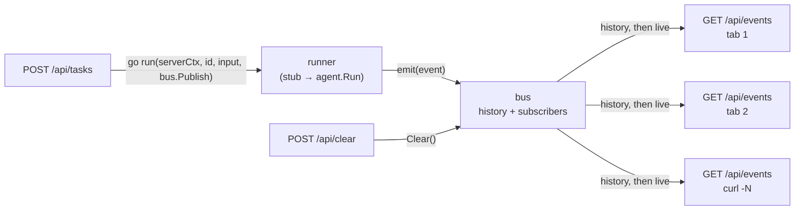

# The event bus and the runner

**In one line:** the runner does the work and announces each step; the bus hands every announcement to whoever is listening, now or later.

## What and Why

**What**
- **Runner:** the function that does a task: `func(ctx, workflowID, input string, emit func(events.Event))`. Today it's the stub (3 events). Later it's `agent.Run` (model + tools). It never returns a result. Everything it has to say goes out through `emit`.
- **Bus:** the middleman between the runner and the SSE handlers. Three jobs:
  - `Publish`: stamp the `id` and `ts`, keep the event in history, and give it to every subscriber;
  - `Subscribe`: get the history so far, plus a channel for new events;
  - `Clear`: forget the history.

**Why: A → B**
- **A, without them:** the POST handler runs the agent and writes to... which tab? It has no idea who's connected.
  - Two tabs means two copies of the logic.
  - A tab that opens late sees nothing.
  - A slow tab makes the agent wait.
  - Testing the HTTP layer needs a real agent.
  - That's the old `/sse` + `messages.Service` (one unbuffered channel): two clients steal events from each other, and the POST blocks when nobody listens.
- **B, with them:**
  - **The runner only knows `emit`.** It doesn't know about HTTP, tabs or SSE. Swap the stub for `agent.Run` and nothing else changes.
  - **The bus does the fan-out and the replay.** It handles N tabs, late tabs and Clear.
  - **The handlers just glue the two together.** POST starts the runner, and GET streams from the bus.
  - **Each piece is testable alone.** In subtask 2 the handlers are tested with a fake bus and a fake runner. That's why both sit behind an interface or a func type that the handler defines.

The course says it best: the event log *is* the system. The bus is where that log lives.

## The picture



```
 POST /api/tasks                                   GET /api/events (one per tab)
      |                                                 ^      ^      ^
      | go run(serverCtx, id, input, bus.Publish)       |      |      |
      v                                                 |      |      |
 +-----------+   emit(event)   +--------------------------------------+
 |  runner   | --------------> |  bus                                 |
 | stub now, |                 |  Publish: stamp id+ts, keep, send    |
 | agent.Run |                 |  Subscribe: history + live channel   |
 |  later    |                 |  Clear: forget history               |
 +-----------+                 +--------------------------------------+
                                          ^
 POST /api/clear  ---- Clear() -----------+

 runner knows: emit.  bus knows: events.  handlers know: HTTP.  nobody knows all three.
```

**One task, in time order**

```
tab 1 connects   -> Subscribe -> history []      + live ch1
POST "hello"     -> 202 {workflowId: W}; go runner(...)
runner           -> Publish workflow.started W   -> ch1
runner           -> Publish log "no agent yet"   -> ch1
runner           -> Publish workflow.completed   -> ch1
tab 2 connects   -> Subscribe -> history [3 events] + live ch2   (replay)
```

## Quick tutorial

**1. The handler defines what it needs.** It doesn't import the real types. This is subtask 2.

```go
type eventBus interface {
	Publish(events.Event)
	Subscribe() (history []events.Event, live <-chan events.Event, unsubscribe func())
	Clear()
}

type runner func(ctx context.Context, workflowID, input string, emit func(events.Event))
```

**2. POST starts the runner and doesn't wait for it.**

```go
workflowID := uuid.NewString()
go run(serverCtx, workflowID, body.Input, bus.Publish)
writeJSON(w, http.StatusAccepted, map[string]string{"workflowId": workflowID})
```

- **`serverCtx`, not `r.Context()`:** the request ends the moment the 202 is sent, and it would cancel the run with it. The server context only ends on Ctrl-C.
- **`bus.Publish` as `emit`:** a method value is a plain `func(events.Event)`, so the runner never sees the bus.

**3. GET streams history first, then live events.**

```go
history, live, unsubscribe := bus.Subscribe()
defer unsubscribe()
for _, e := range history { writeEvent(w, e) }
rc.Flush()
for {
	select {
	case e := <-live:
		writeEvent(w, e)
		rc.Flush()
	case <-r.Context().Done():
		return
	case <-serverCtx.Done():
		return
	}
}
```

**4. In tests, fakes stand in for both.**

```go
type fakeBus struct {
	history []events.Event
	live    chan events.Event
	cleared bool
}

func (f *fakeBus) Publish(e events.Event) { f.live <- e }
func (f *fakeBus) Subscribe() ([]events.Event, <-chan events.Event, func()) {
	return f.history, f.live, func() {}
}
func (f *fakeBus) Clear() { f.cleared = true }
```

A fake runner records what it was called with, for example by sending the id, the input and the ctx down a channel, so the test can check them.

**Rules the real bus follows (subtask 3):**
- `Subscribe` takes the history snapshot and registers the channel under one lock, so no event slips between the two.
- `Publish` never blocks: it uses a buffered channel (256) and drops the event if a tab is that far behind. Parent subtask 4 swaps the drop for cutting the tab off and resuming with `Last-Event-ID`.

## Suggested learning resources

- **Concurrency in Go**, Katherine Cox-Buday (O'Reilly). Read the chapters on channels, `select`, and the "confinement" and "fan-out" patterns.
- **Learning Go, 2nd ed.**, Jon Bodner (O'Reilly). The chapter on concurrency covers when to use a channel and when to use a mutex.
- **Go blog: [Pipelines and cancellation](https://go.dev/blog/pipelines)**, on fan-out and stopping goroutines cleanly.
- **Go blog: [Context](https://go.dev/blog/context)**, on why the run gets `serverCtx` and not `r.Context()`.
- **boot.dev, Learn Go**: the channels and mutexes chapters.

## Follow ups

- Why does `Publish` hold a lock while sending, and why does that force a non-blocking send?
- Pub/sub versus an event log: what changes in Lesson 2 when the history moves to disk?
- Method values (`bus.Publish` as a `func`): how Go binds the receiver.
