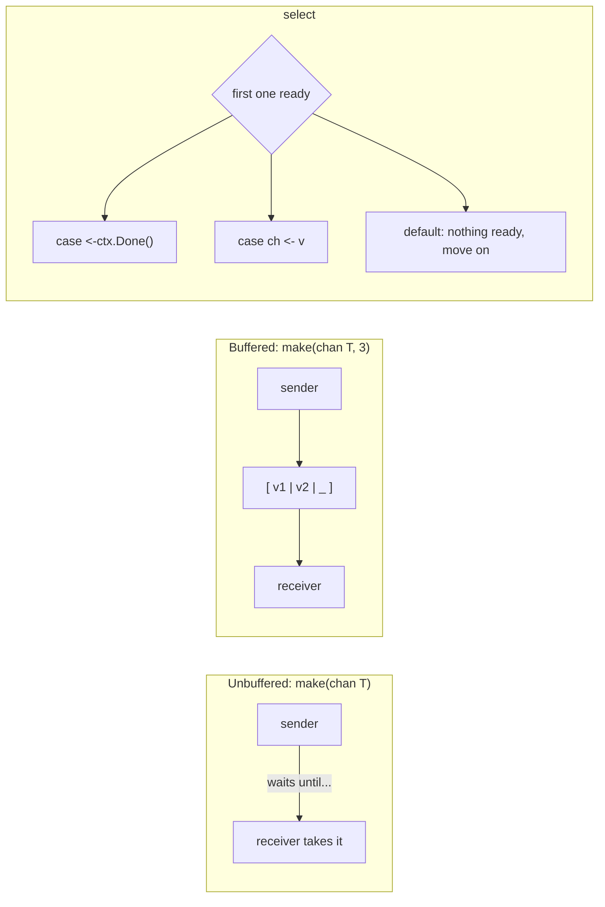

# Go channels

**In one line:** a channel is a typed pipe between goroutines. One side sends a value in, the other side receives it, and the pipe handles the waiting.

## What and Why

**What**
- A channel carries values of one type: `chan events.Event`, `chan struct{}`.
- `ch <- v` sends, and `v := <-ch` receives.
- **Unbuffered** (`make(chan T)`): a send waits until someone receives. It's a handoff.
- **Buffered** (`make(chan T, 256)`): a send only waits when the buffer is full, and a receive only waits when it's empty.
- `close(ch)` says "no more values". Receivers drain what's left, then get the zero value with `ok == false`.
- `select` waits on several channel operations at once, and runs whichever is ready first. With `default`, it doesn't wait at all.

**Why: A → B**
- **A, without channels:** goroutines share variables and guard them with locks. It's easy to forget a lock and get a data race, and hard to see who is waiting on whom.
- **B, with channels:** goroutines pass values instead of sharing them. Whoever holds a value owns it, and waiting is built into the send and receive. Go's motto: *don't communicate by sharing memory; share memory by communicating* (Effective Go).

## The picture



```
 UNBUFFERED                         BUFFERED (cap 3)
 sender ──v──▶ receiver             sender ──▶ [ v1 | v2 | __ ] ──▶ receiver
 blocks until receiver is there     blocks only when all 3 slots are full

 CLOSE                              SELECT
 close(ch)                          select {
 receiver: v1, v2, then             case v := <-a:     ← whichever is
           zero value, ok=false     case b <- x:       ← ready first
 sender after close: PANIC          default:           ← none ready: don't wait
                                    }
```

**The owner goroutine in our bus, `internal/bus/bus.go`:**

```
 Publish ──publishCh────┐
 Subscribe ─subscribeCh─┤      ┌──────────────────────────┐
 unsub ─unsubscribeCh───┼────▶ │ owner goroutine          │──▶ liveEventCh (one per tab, cap 256)
 Clear ──clearCh────────┘      │ only one that touches    │
                               │ streams + history        │──▶ replyCh (history copy, cap 1)
 ctx.Done() ──doneCh──────────▶│ stops when closed        │
                               └──────────────────────────┘
```

## Quick tutorial

```go
package main

import "fmt"

func main() {
	jobs := make(chan string, 2)

	go func() {
		for _, j := range []string{"a", "b", "c"} {
			jobs <- j
		}
		close(jobs)
	}()

	for j := range jobs {
		fmt.Println("got", j)
	}

	full := make(chan int, 1)
	full <- 1
	select {
	case full <- 2:
		fmt.Println("sent")
	default:
		fmt.Println("buffer full, skipped")
	}

	v, ok := <-full
	fmt.Println(v, ok)
	close(full)
	v, ok = <-full
	fmt.Println(v, ok)
	fmt.Println(len(full), cap(full))
}
```

Output (run with `go run`):

```
got a
got b
got c
buffer full, skipped
1 true
0 false
0 1
```

**What each part shows:**
1. **`range` over a channel** keeps receiving until the channel is closed. The sender closes it when it's done, never the receiver.
2. **`select` with `default`** is a send that doesn't wait. That's how the bus skips a tab whose buffer is full.
3. **`v, ok := <-ch`**: `ok` is `false` once the channel is closed and empty, and `v` is then the zero value (`0`).
4. **`len` and `cap`**: `len` counts the values waiting right now, and `cap` is the buffer size. `len` is fine to look at, but don't make decisions with it, because it can change right after you read it.

**Rules worth remembering:**

| Operation | `nil` channel | Open channel | Closed channel |
|---|---|---|---|
| Send `ch <- v` | blocks forever | waits if full or unbuffered | **panic** |
| Receive `<-ch` | blocks forever | waits if empty | zero value, `ok=false`, right away |
| `close(ch)` | **panic** | ok | **panic** |

- **Only the sender closes,** and only once. In the bus, only the owner closes a subscriber's channel.
- **A `nil` channel in a `select` just never fires.** That's why `Subscribe` returning `nil` after shutdown doesn't break the handler: its `ctx.Done()` case wins.
- **`chan<- T` is send-only and `<-chan T` is receive-only.** `Subscribe` returns `<-chan events.Event`, so a handler can't send on it or close it.
- **`chan struct{}` is a signal with no data**, like `clearCh` or `done`. Closing it wakes *every* receiver, which is how `ctx.Done()` works.

## Suggested learning resources

- **Concurrency in Go**, Katherine Cox-Buday (O'Reilly). Chapter 3 covers channels and `select`, and chapter 4 covers patterns: confinement, fan-out, `or-done`.
- **Learning Go, 2nd ed.**, Jon Bodner (O'Reilly). Its concurrency chapter covers buffered vs unbuffered channels, and when to use a channel and when a mutex.
- **Go docs:**
  - [A Tour of Go: Concurrency](https://go.dev/tour/concurrency/2);
  - [Effective Go: Channels](https://go.dev/doc/effective_go#channels);
  - [the spec: Channel types](https://go.dev/ref/spec#Channel_types) and [Select statements](https://go.dev/ref/spec#Select_statements);
  - [Go blog: Pipelines and cancellation](https://go.dev/blog/pipelines);
  - [Go wiki: Mutex or Channel?](https://go.dev/wiki/MutexOrChannel).
- **boot.dev, Learn Go:** the channels chapter.

## Follow ups

- `select` order: when several cases are ready, Go picks one at random. Why does that matter for `doneCh` versus `publishCh` in the bus?
- Fan-out and fan-in: one producer, many consumers, and back again.
- Channel direction in function signatures (`chan<-` and `<-chan`) as documentation that the compiler checks.
- When a `sync.Mutex` is the simpler choice: guarding a counter or a cache, versus handing work over.
